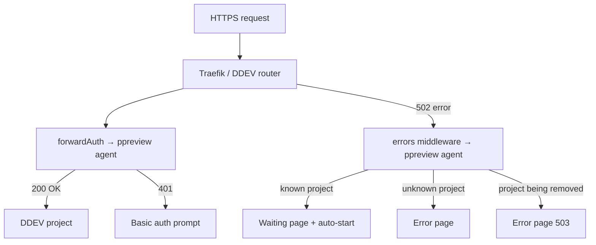

# 🚦 ppreview

[](https://www.npmjs.com/package/ppreview/)
[](https://www.npmjs.com/package/ppreview/)


**DDEV preview environments on your own servers.**

ppreview is pronounced "preview": the first p is silent. It was called Trafic up to version 0.1.64 (`@studiometa/trafic-cli` and `@studiometa/trafic-agent`): see [Migrate from Trafic](docs/agent.md#migrate-from-trafic).

ppreview turns a VPS into a preview server for your web projects. It handles authentication, scale-to-zero, auto-start, and deployments from CI — all powered by [DDEV](https://ddev.com) and [Traefik](https://traefik.io).

## Features

- **DDEV-native** — No custom Dockerfiles needed. Works with WordPress, Laravel, Drupal, and any DDEV-compatible project.
- **Scale-to-zero** — Idle projects are stopped automatically to save RAM. They restart on the next request.
- **Authentication** — Forward auth via Traefik with IP whitelist, tokens, basic auth, and per-hostname rules.
- **Preview environments** — Create and destroy environments from CI, like Vercel but for PHP.
- **Backups on removal** — `destroy --backup` dumps the database and upload directories first.
- **Scheduled removal** — `destroy --delay 48h` keeps a preview for a while; a new deploy cancels it.
- **Running limit** — `max_running_projects` caps how many projects run at once.
- **Simple CLI** — `setup` (server), `deploy` (CI), `destroy` (cleanup).
- **TOML config** — Simple, readable configuration.
- **Zero vendor lock-in** — Runs on any Linux VPS with SSH access.

## How it works



## Quick start

```bash
# Setup a server over SSH (run from your machine or from CI)
npx ppreview setup \
  --host=server.example.com \
  --tld=previews.example.com \
  --email=admin@example.com

# …or run it on the server itself, as root
npx ppreview setup --tld=previews.example.com --email=admin@example.com

# Deploy from CI
npx ppreview deploy \
  --host=server.example.com \
  --name=my-app \
  --branch=main \
  --sync="dist/" \
  --script="composer install --no-dev"

# Your app is live at https://my-app.previews.example.com
```

## Packages

One package, [`ppreview`](packages/ppreview/), holds the CLI and the server agent. CI jobs run `npx ppreview deploy`; the agent code loads only for `ppreview agent <command>`, on the server.

| Part | Description | Documentation |
| ---- | ----------- | ------------- |
| `ppreview setup\|deploy\|destroy` | CLI for deploying projects from CI | [packages/ppreview/README.md](packages/ppreview/README.md) |
| `ppreview agent <command>` | Server agent (auth, scale-to-zero, upgrades) | [docs/agent.md](docs/agent.md) |

## Requirements

**Server:**
- Ubuntu 24.04 LTS
- Root access, or a user with passwordless sudo (for initial setup)
- Wildcard DNS (`*.previews.example.com` → server IP)

**CI:**
- Node.js 24+
- SSH access to the server

## CI examples

<details>
<summary>GitLab CI</summary>

```yaml
deploy_preview:
  stage: deploy
  image: node:24
  before_script:
    - chmod 600 "$SSH_PRIVATE_KEY"
  script:
    - npx ppreview deploy
        --host $SSH_HOST
        --name $CI_PROJECT_PATH_SLUG
        --preview $CI_MERGE_REQUEST_IID
        --ssh-options="-i $SSH_PRIVATE_KEY -o IdentitiesOnly=yes"
        --sync "dist/"
        --script "composer install --no-dev"
  rules:
    - if: $CI_MERGE_REQUEST_ID

destroy_preview:
  stage: deploy
  image: node:24
  when: manual
  before_script:
    - chmod 600 "$SSH_PRIVATE_KEY"
  script:
    - npx ppreview destroy
        --host $SSH_HOST
        --name $CI_PROJECT_PATH_SLUG
        --preview $CI_MERGE_REQUEST_IID
        --ssh-options="-i $SSH_PRIVATE_KEY -o IdentitiesOnly=yes"
  rules:
    - if: $CI_MERGE_REQUEST_ID
```

`SSH_PRIVATE_KEY` is a file-type CI variable. Do not use `ssh-agent` in GitLab CI: see [the CLI README](packages/ppreview/README.md#gitlab-ci).

</details>

<details>
<summary>GitHub Actions</summary>

```yaml
deploy_preview:
  runs-on: ubuntu-latest
  if: github.event_name == 'pull_request'
  steps:
    - uses: actions/checkout@v4
    - uses: webfactory/ssh-agent@v0.9.0
      with:
        ssh-private-key: ${{ secrets.SSH_PRIVATE_KEY }}
    - run: npx ppreview deploy
        --host ${{ vars.SSH_HOST }}
        --name ${{ github.event.repository.name }}
        --preview ${{ github.event.pull_request.number }}
        --sync "dist/"
        --script "composer install --no-dev"

destroy_preview:
  runs-on: ubuntu-latest
  if: github.event_name == 'pull_request' && github.event.action == 'closed'
  steps:
    - uses: webfactory/ssh-agent@v0.9.0
      with:
        ssh-private-key: ${{ secrets.SSH_PRIVATE_KEY }}
    - run: npx ppreview destroy
        --host ${{ vars.SSH_HOST }}
        --name ${{ github.event.repository.name }}
        --preview ${{ github.event.pull_request.number }}
```

</details>

## Agent skills

Two [Agent Skills](https://agentskills.io) teach a coding agent to use ppreview:

- [`ppreview-cli`](skills/ppreview-cli/SKILL.md): write and fix the CI jobs that run `ppreview setup`, `ppreview deploy` and `ppreview destroy`.
- [`ppreview-agent`](skills/ppreview-agent/SKILL.md): operate the server (setup, upgrade, audit, `destroy`, `config.toml`).

Install them in a project or for your user:

```bash
npx skills add weareikko/ppreview
# or, with the GitHub CLI
gh skill install weareikko/ppreview
```

The package also prints the skill that matches its version: `ppreview skill` and `ppreview agent skill`.

## Documentation

- [CLI README](packages/ppreview/README.md) — Deploy and destroy commands
- [Agent README](docs/agent.md) — Server setup and configuration
- [Example config](examples/config.toml) — Full configuration reference

## Contributing

See [CONTRIBUTING.md](CONTRIBUTING.md) for development setup and guidelines.

## Security

See [SECURITY.md](SECURITY.md) for reporting vulnerabilities.

## License

[MIT](LICENSE) © [Studio Meta](https://www.studiometa.fr/)
